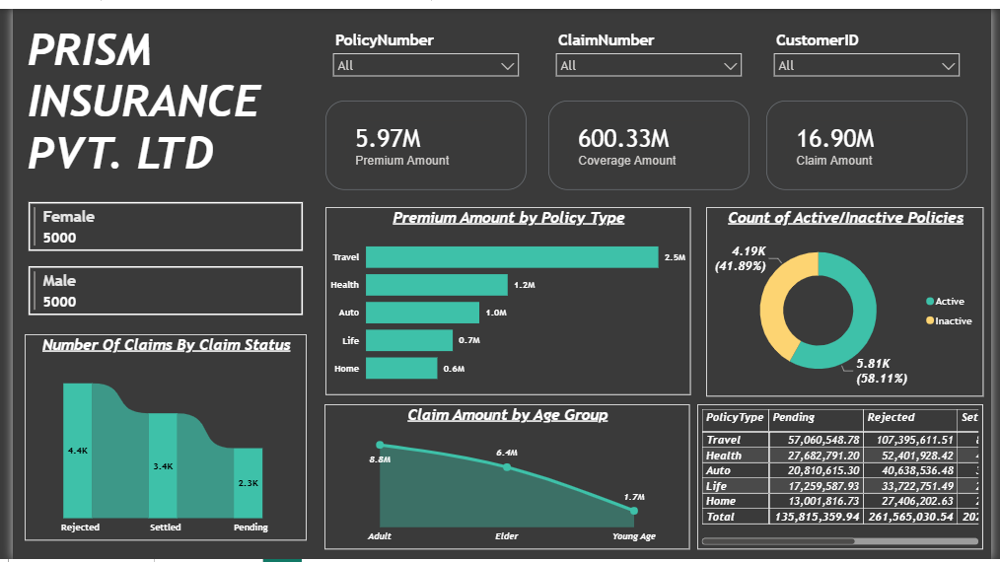
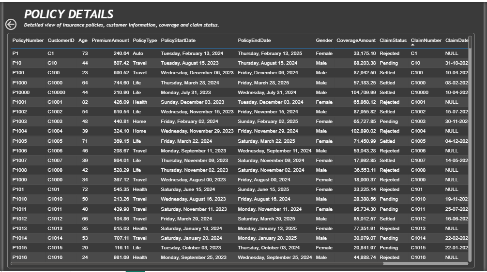

# Insurance Portfolio Analysis & Claims Dashboard | Power BI

## Project Overview

This project presents an interactive **Insurance Portfolio Analysis Dashboard** developed using Microsoft Power BI for PRISM INSURANCE PVT. LTD.

The dashboard provides insights into insurance policies, customer demographics, premium collections, coverage amounts, and claim performance through interactive visualizations and detailed policy-level reporting.

## Business Objectives

- Monitor total premium collections and coverage amounts.
- Analyze insurance claims and their status.
- Understand premium distribution across different policy types.
- Explore customer demographics by age group and gender.
- Analyze active and inactive insurance policies.
- Provide detailed policy-level information for further analysis.

## Dataset Overview

The project uses an insurance dataset containing policy, customer, premium, coverage, and claim-related information.

| Dataset Attribute | Details |
|---|---:|
| Total Records | 10,000 |
| Total Columns | 13 |
| Unique Policy Numbers | 10,000 |
| Unique Customer IDs | 10,000 |
| Unique Claim Numbers | 10,000 |

## Key Performance Indicators

| KPI | Value |
|---|---:|
| Total Premium Amount | 5,974,060.08 |
| Total Coverage Amount | 600,331,176.46 |
| Total Claim Amount | 16,904,295.27 |
| Total Policies | 10,000 |

## Dashboard Preview

### 1. Insurance Overview

The overview page provides a consolidated view of insurance portfolio performance.

**Key insights and visualizations:**
- Total premium, coverage and claim amount KPIs.
- Customer gender distribution.
- Claim status analysis.
- Premium analysis by policy type.
- Claim amount analysis by age group.
- Active vs. inactive policy distribution.
- Coverage analysis by policy type and claim status.

### 2. Policy Details

The policy details page provides a detailed view of individual insurance records, including:

- Policy Number
- Customer ID
- Age and Gender
- Premium Amount
- Coverage Amount
- Policy Type
- Policy Start and End Dates
- Claim Status

## Data Preparation & Cleaning

Data preparation was performed using Power Query.

Key steps included:
- Identifying and removing exact duplicate records.
- Validating financial KPI totals.
- Reviewing missing values in claim-related fields.
- Verifying record counts and policy identifiers.
- Preparing the dataset for interactive analysis.

## Tools & Technologies

- Microsoft Power BI
- Power Query
- CSV Dataset
- Data Cleaning
- Data Analysis
- Data Visualization
- Interactive Dashboard Development

## Repository Contents

| File | Description |
|---|---|
| `Insurance Data Analysis.pbix` | Power BI dashboard file |
| `InsuranceData.csv` | Dataset used for analysis |
| `insurance-overview.png` | Insurance Overview screenshot |
| `policy-details.png` | Policy Details screenshot |
| `README.md` | Project documentation |

## Project Purpose

This project demonstrates practical skills in data preparation, business analysis, KPI reporting, and interactive dashboard development.

It is part of my professional portfolio showcasing my capabilities and continuous learning towards **Data Analyst, BI Analyst and Data Science roles**.

---

**Created by:** Pranil Jadhav

**GitHub Profile:** [praniljadhav-data](https://github.com/praniljadhav-data)
